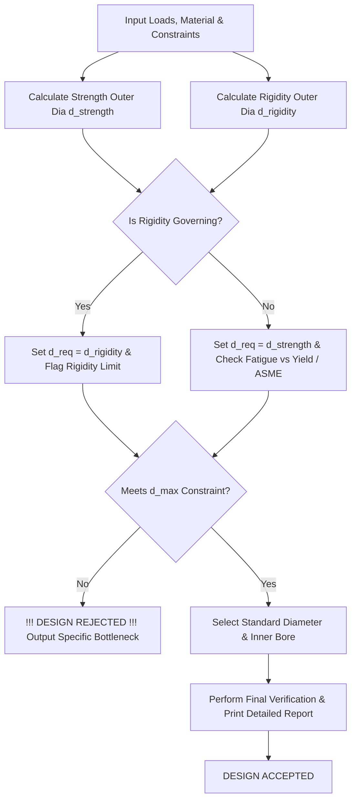

# Power Transmission Shaft Design & Verification Solver

A robust C++17 automated engineering solver and diagnostic tool for power transmission shafts subjected to complex multi-axial loading combinations. This software calculates theoretical required outer and inner diameters, evaluates standardized sizes against physical constraints, and outputs high-fidelity terminal reports detailing the exact mechanical governing failure mode.

##  Directory Structure

```text
omniman2024-shaft-design/
├── README.md
├── build.bat
├── demo_cases.txt
├── individual_terminal_commands.txt
├── Shaft_Design_10_Master_Test_Cases.xlsx
├── Shaft_Design_Master_Test_Cases_Detailed_v2.xlsx
├── data/
│   ├── materials.csv
│   └── standard_diameters.csv
├── include/
│   ├── ASMEDesign.h
│   ├── DesignReport.h
│   ├── FatigueDesign.h
│   ├── MaterialDatabase.h
│   ├── RigidityDesign.h
│   └── StandardShaft.h
└── src/
    ├── ASMEDesign.cpp
    ├── DesignReport.cpp
    ├── FatigueDesign.cpp
    ├── main.cpp
    ├── MaterialDatabase.cpp
    ├── RigidityDesign.cpp
    └── StandardShaft.cpp
```

##  Instructions to Run

1. **Prerequisites:** Ensure you have a C++17 compatible compiler (e.g., GCC/MinGW via MSYS2 or Visual Studio) installed and accessible in your system `PATH`.
2. **Compilation:** Execute the automated compilation batch script from the root directory:
   ```cmd
   build.bat
   ```
3. **Execution:** Run the compiled binary executable from your terminal:
   ```cmd
   shaft_solver.exe
   ```
4. **Reference Files:** You can inspect `demo_cases.txt` or `individual_terminal_commands.txt` for preset execution commands and workflow setups.

##  Logic Flowchart



##  Mechanical Concepts Used

The solver processes mechanical loads through dual engineering frameworks, isolating failures across multiple physical boundaries:

* **Modified Goodman Line (Fatigue):** Evaluates infinite life under fluctuating bending, torsion, and axial stresses. Governs when alternating load components dominate.
* **Langer Yield Line (Plasticity):** Protects against catastrophic plastic deformation under high steady/mean loads.
* **ASME Code (Static Shear):** Utilizes shock/fatigue multipliers ($K_b, K_t$) and von Mises/Maximum Shear principles for peak-load applications. The diagnostic engine classifies ASME failures into:
    * *Axial Collapse*
    * *Bending Dominated*
    * *Torsion Dominated*
    * *Combined Shear*
* **Rigidity Constraints (Max Twist):** Calculates angular deflection using the shear modulus ($G$). Overrides strength requirements whenever strict rotational tolerances ($\theta \le \theta_{max}$) demand a thicker cross-section.
* **Hollow Shaft Geometric Optimization:** Dynamically computes the hollow ratio ($k = d_i / d_o$) under three distinct constraint profiles: Fixed Inner Bore, Fixed Outer Diameter (Bore Maximization), or Uniform Scaling (Fixed Ratio).

